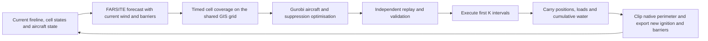

# What changed from static v3 and how the integration works

## Intended dynamic experiment

The goal is to route tankers and scoopers over an evolving fire, let their water
drops affect the next fire-growth calculation, and repeatedly update the plan
without resetting aircraft or suppression state. This implements iterative
coupling from the problem statement, with a forecast available within each
optimisation window.

`integration/static_v3` is the baseline. Its aircraft movement, water conservation,
service durations, shared depot, deterministic cumulative-water suppression,
hexagonal cell-integrated footprint and two-pass objective were retained.
The new folder contains copies of these components and does not import or modify
the baseline implementation. Its input TIFF and ignition shapefile components
were copied unchanged from the working static v3 folder.

## Static versus dynamic

| Aspect | Static v3 | integration_v2 |
| --- | --- | --- |
| Fire | One fixed set of burning cells. | New cells become burning at forecast times; permanent suppression persists. |
| Fire engine | None. | Real FlamMap FARSITE DLL, optional TestFARSITE executable, or an explicit synthetic demo. |
| Optimisation | One finite-horizon solve. | A fresh solve after every committed execution prefix. |
| Initial aircraft state | Every aircraft at the depot, full. | Actual position and remaining water carried from the previous execution. |
| Previous water | Starts at zero. | Partial delivered water carried per burning cell; no free refill or reset. |
| Plan execution | Whole solution replayed. | Only the first K intervals executed; future actions discarded. |
| Suppression feedback | No subsequent growth. | Extinguished areas removed from next ignition and supplied as filled native barriers. |
| Fireline | Initial polygon and fixed grid. | Continuous native perimeter retained, clipped by suppression and exported automatically. |
| GIS | Fixed ignition rasterised once. | Native output grids checked, timed polygons mapped by exact area, fireline and barriers rewritten each window. |
| Weather | Not needed for spread. | Reproducible wind per window, shared with forecast and optional drop heading. |
| Results | One proposed schedule. | Per-window plans, executed actions, checkpoints and a combined executed trajectory. |

## The feedback loop



At elapsed time n, FARSITE starts from the *current* unsuppressed continuous
perimeter and forecasts at least W optimiser intervals. Gurobi plans W intervals,
but only K are committed. The next cycle begins at n+K, not n+W. Defaults for
research runs are W=15 and K=3, with one minute per interval.

The controller assigns a global simulation clock. Native requests write start
and end as calendar `month day HHMM`, advancing across midnight; returned
perimeters are mapped by their elapsed minutes relative to the controller's
window start. Raw native calendar labels are not used as the global clock.
The generated RAWS stream covers three conditioning days and a trailing day.
Native simulations are extended to at least 60 minutes by default; extra
forecast time is not executed or charged. Native validation rejects durations
below ten minutes, and testing this installed build showed that short requests
could return stationary perimeters. A full-hour forecast produced actual growth
in the control case; incomplete early fuel conditioning is the suspected cause,
not a verified internal diagnosis of the closed installed binary.
`minimum_forecast_minutes` makes this explicit and configurable.

The native adapter checks both process success and required output files; some
console builds return zero after an internal error. Missing output, malformed
GIS, a native timeout, infeasibility, or a solve without an incumbent produces an
explicit failure rather than silently using an old perimeter or the demo.

## What FARSITE does

FARSITE supplies fire growth driven by landscape fuel, terrain and weather. It
does not choose aircraft routes or interpret litres of dropped water. FlamMap's
FARSITE module is the time-evolving engine; FlamMap Basic's single-condition
fire-behaviour output is not substituted for it. See the official
[FARSITE description](https://wfdss.firenet.gov/help/Content/20-Incidents/22-Analysis/FARSITE.htm).

On this machine the default backend calls the installed `farsite.dll` through
`native_worker.py`, using the exported `CFarsite` interface. Native GDAL drivers
are initialised before loading a landscape. The public
[FARSITE header](https://github.com/mbedward/farsite/blob/master/src/FARSITE.h)
defines the class wrapper. The bridge uses its Windows x64 member-call ABI and
checks the required decorated symbols. Each call runs in a separate process so
the native DLLs and their GDAL version remain separate from Python's rasterio
and its GDAL version. A timeout bounds each forecast. This ABI bridge is specific
to compatible Windows x64 builds; another DLL version must pass the interface
probe and native validation. The alternative console adapter uses the
[six-field batch protocol](https://github.com/mbedward/farsite/blob/master/src/TestFARSITE.cpp).

The installed DLL requires ignition setup **before** loading weather/model
inputs: its ignition setup otherwise resets native model state. A native growth
regression test checks this, beyond merely checking that a DLL call returns
success. Its raw Month/Day/Hour attributes reset between restarts in testing;
the adapter uses `Elapsed_Mi` relative to the controller's window start for
coupling and does not use those raw calendar attributes as a global clock.

Each native directory holds a short relative command:

```text
landscape.lcp weather.input ignition.shp barriers.shp fire 1
```

`0` replaces the barrier path when there are no extinguished cells. Short
relative names avoid the old batch parser's inability to quote paths containing
spaces. The working directory can still contain spaces.

The native arrival raster is read and checked as a diagnostic. Rate of spread
is never interpreted as burning status. The native timed perimeter polygons
provide the actual cell coverage forecast. For each optimiser boundary, a cell
becomes burning when its intersection with the fire polygon reaches at least
the configured fraction of cell area. The default is 0.5, preserving static
v3's `>=50%` implementation. The statement says “more than 50%”; the equality
case remains the baseline convention and can be changed deliberately for a
strict-threshold experiment. Native perimeter timestamps must include every
requested boundary; missing timestamps are rejected rather than guessed.

The continuous perimeter at the committed boundary is retained for the next
native ignition. It is **not replaced by whole raster cells**: replacing it each
time would erase subcell growth and can stall a slow fire indefinitely when it
takes longer than K intervals to cross a cell. Extinguished cell polygons are
subtracted from that perimeter and supplied as filled barriers. The exported
`fireline.gpkg` is its boundary. Even if no cell yet meets the 50% rule, a
remaining subcell fire perimeter prevents a premature “extinguished” result.

## What Gurobi does

The forecast supplies candidate burning cells and their release boundaries
`a[c]`. The model retains the compact integer aircraft coordinates and actual
Manhattan displacement from v3; it does not enumerate all cell-to-cell arcs.

For each candidate cell and boundary, cumulative credited water is:

```text
L[c,0] = actual water already delivered before this window
L[c,t] = L[c,t-1] + eligible deposits completing at boundary t
E[c,t] = 1 if and only if L[c,t] >= cell water demand
burning[c,t] = 1{t >= a[c]} * (1 - E[c,t])
```

These use integer litres and the same exact threshold implications as v3. A drop
cannot start before its origin ignites or after that origin is extinguished.
A drop consumes water at its start and credits its footprint at completion.
Only cells burning by completion receive cumulative suppression credit. Water
landing on unburned cells is not stored as preventive wetting. Previously
extinguished cells remain permanently extinguished.

Aircraft start at their actual carried row, column and load. Refill actions
restore full capacity only at completion, at an eligible source. A source
forecast to be burning by completion cannot be used. If a service site actually
becomes burning, the next window fails with a relocation diagnostic; automatic
infrastructure relocation is outside the model.

Tankers must be able to return to the airfield by the end of the proposed
horizon; scooper return remains configurable. After the last fire is suppressed,
the loop continues long enough to execute required returns, subject to the
simulation limit.

Services cannot straddle the committed boundary. Otherwise a refill or drop
could be partly executed and then lost when the next model was constructed.
The configured K must therefore be at least the longest active service duration.
This is a scheduling restriction: choose shorter service intervals or a larger
K when changing aircraft processing times. The final shortened window naturally
excludes services that cannot finish before the simulation limit.

The primary objective remains burning-cell samples over boundaries 1..W. The
second pass minimises actual flight distance while preserving the primary
incumbent. These are per-window plans; there is no claim of global optimality
over the entire rolling simulation. The final report sums only executed
boundaries and movement. Time to extinguishment is an outcome, not a newly
introduced independent third objective.

## What happens when a plan is executed

`replay.py` independently checks route continuity, speed, occupancy, starting
state, service location/duration, water balance, drop eligibility, cumulative
suppression, the predicted fire trajectory and both objectives. A plan is
accepted only if this replay agrees with the MILP.

The controller takes state, deposition and aircraft positions at boundary K.
Only actions completing by K enter the executed action log. Actions planned
after K neither consume real water nor extinguish cells. These executed values
become the next window's initial conditions. The rest of the old plan is
discarded and may change in response to the new fireline and wind.

## Scientific limits and choices

The coupling is discrete. Within a committed prefix, growth follows the forecast
computed before that prefix's drops; suppression changes propagation at the
next native restart. The optimiser can see future arrivals, but it does not
differentiate the native fire model or remove all forecast descendants of a
planned suppression. K therefore controls a real coupling approximation. This
must be reported and studied through window-size sensitivity, not described as
exact continuous-time suppression physics.

The three-state baseline has no natural burnout or reignition. Filled barriers
implement the permanently extinguished assumption; permanent water barriers
are not a calibrated physical model of water evaporation or retardant duration.
Native restarts preserve the continuous perimeter but not FARSITE's complete
internal combustion, acceleration or fuel-moisture state. Native acceleration is
enabled and restarts with each forecast; uniform demonstration weather is
regenerated for each forecast. This restart bias and the raw native clock reset
limit interpretation of long-duration runs with changing observations. Observed weather,
moisture calibration and a fully stateful simulator restart are future research
extensions, not implied by this implementation.

The cumulative-water demand remains the static demonstration assumption of
1 L/m². It is not an empirical suppression law. Drop geometry, stationary service
manoeuvres, Manhattan travel, sampled collision avoidance and placeholder service
sites retain the baseline's limits.

The native demonstration validates native execution and data exchange on a
synthetic landscape. It is not a validated wildfire prediction. The graph demo
uses synthetic wind-biased Moore-neighbour travel; it carries fractional
ignition times between windows so slow spread is not reset by replanning.

## Input issue discovered during implementation

The copied 82×230 landscape contains valid elevation/slope/aspect, but **every
value of bands 4–8 is -9999**. It cannot provide real fuel-driven spread.
The older `integration/inputs/landscape.lcp` and `Test_Integration/landscape.lcp`
are a different 1159×3432 grid; the latter also has a different Albers CRS. They
are not interchangeable with the working static grid.

`export_landscape()` preserves all source pixels and writes a companion `.prj`;
this was verified by array equality after LCP round-trip. The
[GDAL LCP documentation](https://gdal.org/en/stable/drivers/raster/lcp.html)
describes band order and creation units. Native preparation does not invent
missing research fuel data. Obtain a complete landscape for the same area, or
explicitly use `--native-demo` for the generated test data.

## Code map

| File | Responsibility |
| --- | --- |
| `run_dynamic.py` | CLI, paths, configuration, prerequisites and synthetic native landscape. |
| `config.py`, `settings_base.py` | Dynamic controls and copied aircraft/footprint settings. |
| `scenario.py` | Carried world state and each timed optimisation window. |
| `fire_engine.py`, `native_worker.py` | Forecast backends, weather generation and isolated native execution. |
| `fire_io.py`, `grid_utils.py` | Shared GIS grid, LCP export, timed coverage, continuous perimeter and fireline/barrier export. |
| `optimisation.py` | Extended v3 MILP and two-pass solve. |
| `replay.py` | Independent validation and forecast-aware replay. |
| `orchestrator.py` | Prefix execution, feedback, checkpoints and final metrics. |
| `drop_pattern.py` | Unchanged static v3 integrated hexagonal deposition. |
| `wind.py`, `visualise.py` | Repeatable wind samples and executed/forecast visualisations. |
